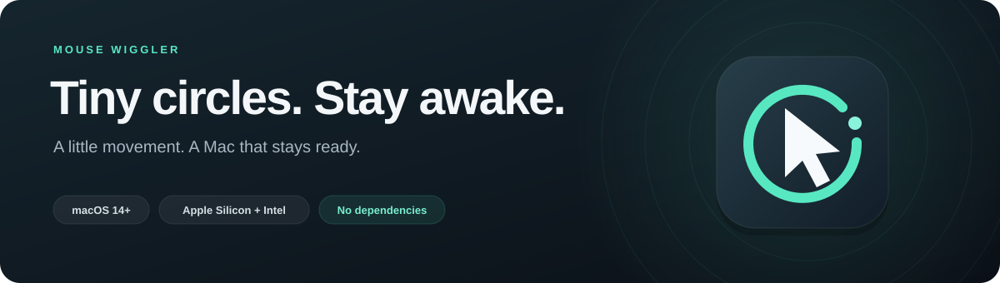
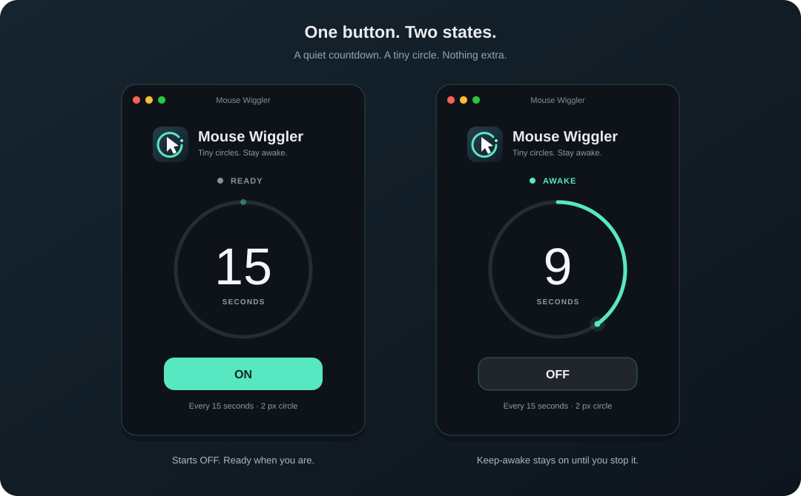

<p align="center">
  A tiny, native macOS utility. One button. A circular countdown. A Mac that stays ready.
</p>
<p align="center">
  <a href="https://github.com/byalcin23/mouse-wiggler/releases/latest"><strong>Download for macOS ↗</strong></a>
  &nbsp; · &nbsp;
  <a href="#install">Installation</a>
  &nbsp; · &nbsp;
  <a href="#build-from-source">Build from source</a>
</p>



<p align="center"><sub>Illustrated interface previews · Dark navy, mint accents, and a 15-second countdown.</sub></p>

## Small by design

| | What you get |
| :--- | :--- |
| ◉ **Tiny movement** | A quick, approximately 2-pixel-diameter cursor circle every 15 seconds. |
| ◷ **Visible countdown** | A circular timer shows when the next movement happens. |
| ☀ **Native keep-awake** | macOS IOKit power assertions keep idle sleep at bay while ON. |
| ⌘ **Universal app** | Apple Silicon + Intel. No Python, Homebrew, or runtime dependencies. |
| ◇ **Private & local** | No network requests, analytics, login item, or background service. |

## Install

| Step | Action |
| :---: | :--- |
| **01 · Download** | Get the latest **universal DMG** from [Releases](https://github.com/byalcin23/mouse-wiggler/releases/latest). |
| **02 · Install** | Open the DMG and drag **Mouse Wiggler → Applications**. |
| **03 · Allow** | Open the app. Enable it in **System Settings → Privacy & Security → Accessibility**. If missing, add it using **+**. |
| **04 · Start** | Press **ON** again after granting permission. That's it. |

**Requirements:** macOS 14 Sonoma or later, Apple Silicon or Intel.

> **Before you open:** The release is ad-hoc signed, **not Apple Developer ID signed or notarized**. macOS may block an app downloaded from GitHub. Only if you trust this source, use the per-app **Open Anyway** option in **System Settings → Privacy & Security**, then confirm opening the app. Do not disable Gatekeeper globally. On managed Macs, your administrator may need to approve it.

<details>
<summary><strong>Prefer a ZIP? Want to verify your download?</strong></summary>

A ZIP and SHA-256 checksums are also provided with each release. To check a downloaded package, run `shasum -a 256` on it and compare its hash with `SHA256SUMS.txt` from the same release.

</details>

## Use

| State | Behavior |
| :--- | :--- |
| **ON → AWAKE** | Keeps the display and Mac from automatically sleeping due to inactivity. Every 15 seconds, the cursor traces a tiny circle and returns to its starting point. |
| **OFF → READY** | Stops the countdown and movement; releases the keep-awake assertion immediately. |
| **Close window** | Quits the app and releases the assertion. The app always starts OFF. |

Movement is skipped while a mouse button is held. If the cursor moves more than 4 pixels from the expected position during a circle, the animation stops rather than pulling it back.

Keep-awake uses macOS IOKit power assertions, not only synthetic mouse input. It does not change persistent power settings, bypass a locked screen, override administrator security policies, or prevent sleep caused by closing the lid, choosing Sleep, or a low battery. Keeping the display awake increases battery usage.

<details>
<summary><strong>Permissions & uninstalling</strong></summary>

Accessibility permission is used only to move the cursor while enabled. Removing the app from Applications uninstalls it; you can also remove its Accessibility permission.

</details>

## Build from source

<details>
<summary><strong>Build the app or package your own installer</strong></summary>

Install Apple's Xcode Command Line Tools (`xcode-select --install`), then:

```sh
./build.sh
open 'Mouse Wiggler.app'
```

Or double-click `start.command`; it builds the app when needed and opens it. The build produces a universal Apple Silicon + Intel app and ad-hoc signs it locally. Rebuilding may require regranting Accessibility permission.

To create the drag-to-Applications DMG, ZIP, and checksums:

```sh
./package.sh
```

Output is written to `dist/`. Build output and packages are excluded from Git; downloadable binaries are attached to GitHub Releases.

</details>

## References

- [Apple: Prevent user-idle display sleep](https://developer.apple.com/documentation/iokit/kiopmassertiontypepreventuseridledisplaysleep)
- [Apple: IOPMAssertionCreateWithName](https://developer.apple.com/documentation/iokit/1557134-iopmassertioncreatewithname)
- [Apple: App icons](https://developer.apple.com/design/human-interface-guidelines/app-icons)
- [Apple: Progress indicators](https://developer.apple.com/design/human-interface-guidelines/progress-indicators)
